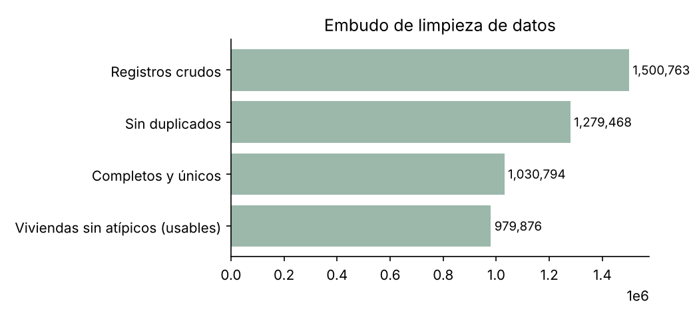
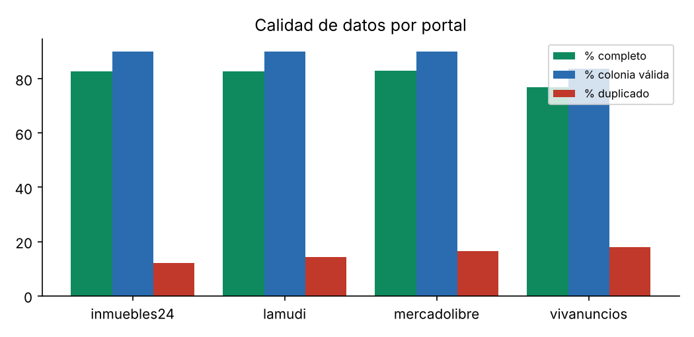
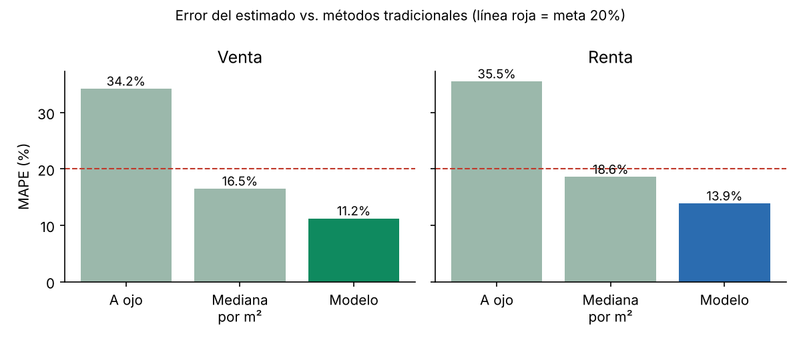
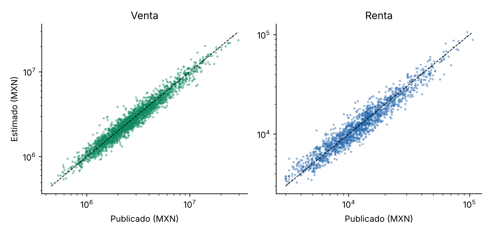
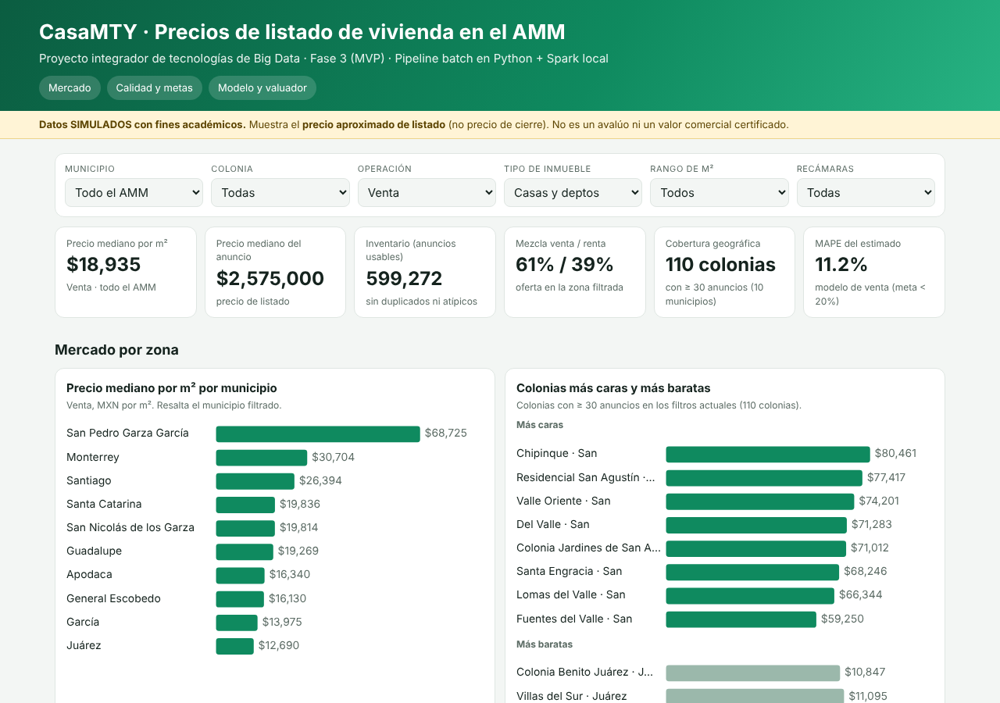

> **Aviso importante.** El dataset de esta fase es **simulado** (la guía de la Fase 3 permite dataset simulado o real y la Fase 2 ya lo
> había previsto como riesgo controlado). Las cifras de precio y de error describen el comportamiento del *pipeline* y del modelo sobre
> datos sintéticos; **no son estadísticas del mercado real** del AMM. El tablero siempre habla de *precio aproximado de listado*, nunca de avalúo.

# 1. Resumen ejecutivo

CasaMTY es un prototipo funcional que recibe anuncios de vivienda de cuatro portales con formatos distintos, los limpia y unifica con
**Apache Spark en modo local**, los guarda en un **Data Lake por capas** (bronce / plata / oro), los modela en un **warehouse tipo estrella**,
estima el precio de listado con un modelo simple y lo muestra en un **dashboard** con filtros por municipio, colonia, operación, tipo, rango de m² y recámaras.

| Indicador | Resultado de la corrida |
|---|---|
| Registros crudos procesados | **1,500,763** (meta ≥ 1,000,000) |
| Registros únicos tras quitar duplicados | 1,279,468 |
| Registros usables para precio (completos, únicos, sin atípicos) | 979,876 |
| Completitud de campos clave | **81.62%** (meta > 70%) |
| Tasa de duplicados detectados | 14.75% |
| MAPE del estimado (venta / renta) | **11.23% / 13.88%** (meta < 20%) |
| Reducción de error vs. "a ojo" (venta / renta) | 67.2% / 60.9% |
| Tiempo del pipeline (ingesta simulada + Spark + modelo + warehouse) | **4.3 min** (meta < 30 min) |
| Municipios / colonias con datos | 10 / 110 |
| Costo de licencias | $0 |

# 2. Alcance del MVP y cumplimiento de la guía (sección 3.1)

| Requisito de la guía | Cómo se cumple | Dónde está |
|---|---|---|
| Dataset ≥ 1 millón de registros (simulado o real) | 1,500,763 registros crudos en 4 portales y 3 corridas semanales | `src/etapa1_ingesta_bronce.py`, `data/lake/bronce/` |
| Limpieza y transformación en Python | Generación, defectos controlados, normalización de texto, modelo y reporte en Python | `src/` |
| Procesamiento distribuido en Apache Spark | PySpark (`local[*]`): unión de esquemas, parseo de precios, catálogos *broadcast*, ventanas para duplicados, agregados | `src/etapa2_plata_spark.py`, `src/etapa3_oro_spark.py` |
| Almacenamiento estructurado | Parquet por capas + warehouse estrella (SQLite incluido; PostgreSQL opcional) | `data/lake/`, `src/etapa5_warehouse.py`, `sql/` |
| Dashboard funcional | `dashboard/index.html` (se abre sin instalar nada) y `powerbi/` + guía para Power BI Desktop | `dashboard/`, `powerbi/`, `docs/guia_powerbi.md` |

Lo que **no** se hizo y por qué: no se instaló MongoDB (la Fase 2 lo preveía para los documentos crudos; en el MVP los documentos crudos viven como JSONL
en la capa bronce y hay un script opcional `src/opcional_mongodb.py` para cargarlos); no se usó Kafka ni Airflow (decisión de la Fase 2: batch diario, orquestador en script);
y no se hizo *scraping* real de portales. Todo eso queda como mejora de la Fase 4.

# 3. Arquitectura implementada

```
 4 portales (esquemas distintos)        Python (batch)                 Spark local
 inmuebles24 · lamudi · vivanuncios ──►  etapa 1: ingesta  ──►  BRONCE  ──►  etapa 2: limpieza  ──►  PLATA
 mercadolibre   (JSONL.gz por corrida)   (dataset simulado)    (crudo)        (unifica, normaliza,    (Parquet)
                                                                               duplicados, calidad)
                                                                                        │
   Dashboard HTML  ◄── etapa 6 ◄── ORO ◄── etapa 3 (modelo estrella + agregados)  ◄──────┘
   Power BI (CSV)  ◄──────────────  │
                                     ├── etapa 4: modelo de estimación  ──►  hecho_estimacion
                                     └── etapa 5: warehouse (SQLite / PostgreSQL)
```

Orquestación: `correr_pipeline.py` ejecuta las 7 etapas en orden, mide el tiempo de cada una y se detiene si alguna falla
(equivalente escolar de Airflow, como se definió en la Fase 2). Se puede programar con el Programador de tareas de Windows o con `cron`.

# 4. Dataset (simulado) y las 5V

* **Volumen:** 1,500,763 registros crudos (~1,229,508 inmuebles únicos). Los 4 portales aportan 35 % / 25 % / 20 % / 20 %.
* **Velocidad:** 3 corridas semanales; un anuncio puede reaparecer en la corrida siguiente (recaptura) con 3 % de cambio de precio. El pipeline completo se repite con un solo comando.
* **Variedad:** cada portal usa nombres de campo, formatos de precio y anidación distintos (texto "$4.50 MDP", "USD 250,000", número plano, objeto `price.amount`, "151 m²", `atributos.COVERED_AREA`, "Colonia, Municipio" en un solo campo).
* **Veracidad:** se inyectan defectos controlados para poder medir calidad: m² faltantes (7 %) o inflados (3 %), precio faltante, renta capturada como venta, colonias con typos / sin acentos / en mayúsculas / con "Col.", municipio con alias ("SPGG", "Sta. Catarina"), duplicados entre portales y recapturas.
* **Valor:** estimar el precio aproximado de listado de una zona y comparar contra el precio publicado.

Los municipios y colonias del catálogo son reales (AMM), pero los **factores de precio por colonia son supuestos de diseño**, no cifras oficiales.

# 5. Resultados de la limpieza (Spark)

{width=85%}

| Portal | Registros | % completo | % m² válido | % colonia válida | % duplicado |
|---|---|---|---|---|---|
| inmuebles24 | 509,724 | 82.77% | 92.99% | 89.91% | 12.19% |
| lamudi | 374,757 | 82.81% | 93.03% | 89.94% | 14.27% |
| mercadolibre | 308,269 | 82.89% | 92.94% | 90.09% | 16.43% |
| vivanuncios | 308,013 | 76.99% | 92.95% | 83.65% | 17.87% |
| **Total** | **1,500,763** | **81.62%** | **92.98%** | **88.67%** | **14.75%** |

* Duplicados por recaptura (mismo portal e id, corrida más vieja): 147,996.
* Duplicados entre portales (misma zona, tipo, operación, m², recámaras y precio): 73,299.
* Anuncios en USD convertidos a MXN con tipo de cambio fijo de 18.0: 12,751.
* Regla de atípicos: se descarta un registro cuyo precio por m² quede fuera de [mediana/3, mediana×3] de su municipio, operación y tipo (esto atrapa, por ejemplo, rentas capturadas como venta).
* Venta y renta **nunca** se mezclan en un mismo KPI de precio.

{width=75%}

# 6. Modelo de estimación (sección 3.2: indicadores)

Pregunta de la Fase 1: ¿se puede estimar el precio de listado con un error aceptable usando solo atributos publicados?

Se entrenó un `HistGradientBoostingRegressor` (scikit-learn) por operación, con variables: municipio, colonia, tipo, m², recámaras, baños y estacionamientos.
Se evalúa en el 20 % de los datos que **no** se usó para entrenar y se compara contra dos métodos tradicionales.

| Método | Venta: MAPE / MAE (MXN) / % dentro de ±20 % | Renta: MAPE / MAE (MXN) / % dentro de ±20 % |
|---|---|---|
| A ojo (promedio del municipio) | 34.23% / 1,005,514 / 39.9% | 35.53% / 4,671 / 38.8% |
| Mediana por m² del municipio × m² | 16.51% / 559,621 / 70.6% | 18.59% / 2,801 / 65.0% |
| **Modelo CasaMTY** | **11.23% / 371,239 / 85.7%** | **13.88% / 2,058 / 76.5%** |

* Reducción de error del modelo frente al método "a ojo": **67.2 %** en venta y **60.9 %** en renta.
* Variables más influyentes en venta (importancia por permutación): id_colonia (0.8524), m2 (0.5991), recamaras (0.083), id_municipio (0.0223).
* Zonas (colonia × tipo × operación) con ≥ 30 anuncios: 440 de 440; de ellas, **100.0 %** cumplen MAPE < 20 %.
* Tiempo de entrenamiento total: 3.9 s.

{width=80%}

{width=80%}

**Cómo leer estos números con honestidad.** Como los datos son sintéticos y el precio se generó con una fórmula que depende de zona, tamaño y recámaras (más ruido),
es *esperable* que un modelo que usa esas mismas variables lo recupere bien. El resultado demuestra que el pipeline y el modelo funcionan de punta a punta
y que el diseño de variables es coherente; **no demuestra** que el mercado real se pueda estimar con ese error. Con datos reales, el MAPE sería mayor
(estado físico, vista, negociación, antigüedad, etc.), y esa validación queda como trabajo de la Fase 4.

# 7. Indicadores técnicos y de negocio (métricas obtenidas)

| Indicador | Meta (Fase 2) | Resultado |
|---|---|---|
| Tiempo promedio de procesamiento (pipeline) | < 30 min | 4.3 min |
| Completitud de campos clave | > 70 % | 81.62 % |
| Tasa de duplicados | registrar y bajar | 14.75 % detectados y marcados |
| MAPE del estimado | < 20 % | venta 11.23 % · renta 13.88 % |
| Reducción de error vs. método tradicional | informativo | 67.2 % venta · 60.9 % renta |
| Cobertura AMM | ≥ 8 municipios | 10 municipios · 110 colonias |
| Costo de licencias | $0 | $0 |
| Costo por consulta analítica | informativo | 6.283 s promedio, $0 (SQLite local) |
| Valor de uso del tablero | ≤ 3 clics | 2 selecciones (municipio → colonia) |

Tiempos por etapa (hardware de la corrida: 2 núcleos, 7 GB de RAM):

| Etapa | Tiempo |
|---|---|
| Etapa 1 | 17.5 s |
| Etapa 2 | 82.7 s |
| Etapa 3 | 37.6 s |
| Etapa 4 | 14.1 s |
| Etapa 5 | 107.5 s |
| Etapa 6 | 1.9 s |

Consultas analíticas típicas sobre el warehouse (1,500,763 filas en `hecho_anuncio`, tamaño del archivo 157.5 MB):

| Consulta | Mejor de 3 corridas |
|---|---|
| precio_m2_promedio_por_municipio_casas_venta | 1.547 s |
| inventario_por_operacion_y_tipo | 1.052 s |
| tasa_duplicados_por_fuente | 0.663 s |
| top10_colonias_mas_caras_casas_venta | 0.0 s |
| anuncios_sobre_precio_estimado_san_pedro | 28.153 s |

La etapa de ingesta incluye la **generación** del dataset simulado; con datos reales ese tiempo sería de descarga y dependería de los portales.

# 8. Modelo de datos del warehouse

Esquema estrella definido en la Fase 2: `hecho_anuncio` y `hecho_estimacion` como hechos; `dim_ubicacion`, `dim_inmueble_tipo`, `dim_operacion` y `dim_fuente` como dimensiones.
El DDL para PostgreSQL está en `sql/esquema_postgresql.sql`; las consultas de ejemplo para Power BI, en `sql/consultas_ejemplo.sql`.

# 9. Dashboard operativo

`dashboard/index.html` incluye: filtros (municipio, colonia, operación, tipo, rango de m², recámaras), tarjetas KPI (precio mediano por m², inventario, mezcla venta/renta,
cobertura, MAPE), precio por municipio, colonias más caras y más baratas, histograma, tendencia semanal, estructura de la oferta, calidad por portal, embudo de limpieza,
tabla de cumplimiento de metas, comparación del modelo y un **valuador de orientación** (captura colonia, tipo, m² y recámaras y entrega rango y nivel de confianza).
Las capturas están en `docs/img/dashboard_*.png`. Para la versión Power BI Desktop (la que nombra la guía), ver `docs/guia_powerbi.md`.

{width=100%}

# 10. Propuesta de mejora organizacional (sección 3.3)

Ver `docs/propuesta_organizacional.md` (roles, procesos, gobierno de datos, seguridad y cumplimiento). Resumen:

* **Roles:** Data Engineer (pipeline y lake), Data Analyst (tablero y KPIs), responsable de calidad de datos (*data steward*), y un dueño del producto que decide qué se publica.
* **Procesos:** corrida semanal programada, revisión de calidad antes de publicar (completitud, duplicados, atípicos), bitácora de métricas por corrida y control de versiones del código.
* **Gobierno de datos:** catálogo y diccionario de datos, reglas de calidad versionadas, linaje bronce → plata → oro y etiqueta obligatoria de "simulado" o "precio de listado".
* **Seguridad y cumplimiento:** sin teléfonos, nombres de vendedores ni fotos; solo datos públicos de mercado; respetar términos de uso y `robots.txt` si algún día se hace *scraping*; aviso de privacidad si se usaran datos personales (LFPDPPP).

# 11. Limitaciones y trabajo futuro

1. **Datos simulados.** El siguiente paso es sustituir la etapa 1 por una ingesta real y ética (descargas públicas, API autorizada o *scraping* respetuoso) conservando el mismo esquema bronce.
2. **El modelo no está validado con mercado real.** Hay que reportar el MAPE con datos reales y por municipio.
3. **Warehouse local.** SQLite cumple para el MVP; la Fase 2 definió PostgreSQL (el script ya acepta una URL de SQLAlchemy).
4. **Sin MongoDB, Kafka ni Airflow** en el MVP, por la decisión de escala de la Fase 2.
5. **Detección de duplicados entre portales** es por coincidencia exacta de zona, m², recámaras y precio; con datos reales conviene una comparación aproximada (*fuzzy*).
6. **Tipo de cambio fijo** para anuncios en USD.
7. **Tendencia semanal** con solo 3 corridas; no hay series largas.

# 12. Cómo reproducir

```
pip install -r requirements.txt
python correr_pipeline.py            # 1.5 millones de registros
python correr_pipeline.py --n 100000 # prueba rápida
```

Requiere Python 3.10+ y Java 11/17/21 (para Spark). Detalles en `README.md`.
